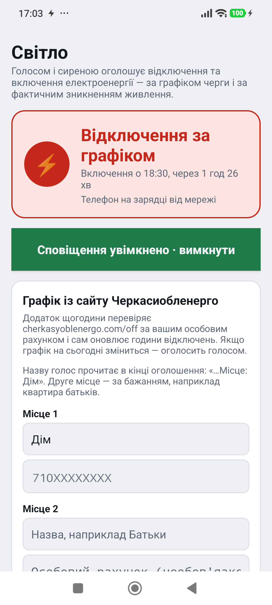
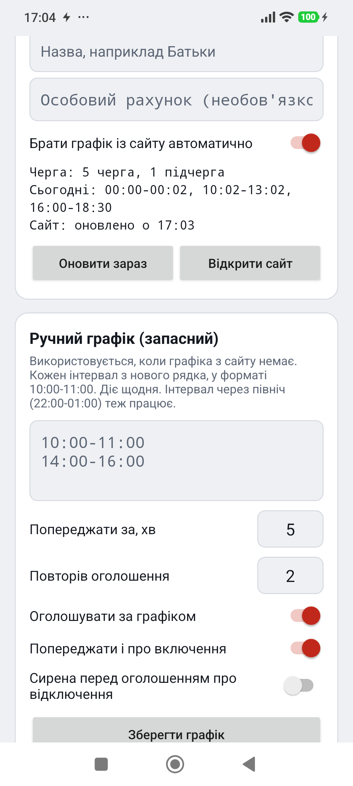
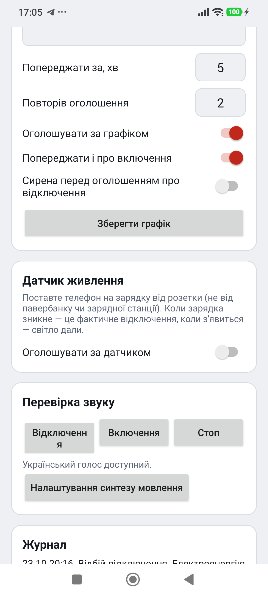

# Світло — голосові сповіщення про відключення світла

Android-додаток, який, як повітряна тривога, голосом українською оголошує відключення і включення електроенергії за графіком Черкасиобленерго.

- **«Увага! Відключення електроенергії… Місце: Дім.»** — із сиреною;
- **«Відбій відключення. Електроенергію відновлено.»** — із сигналом;
- попередження за 5 хвилин до відключення і до включення;
- лунає навіть у беззвучному режимі (потік будильника);
- графік береться з сайту обленерго за особовим рахунком, до двох місць (наприклад, дім і батьки);
- телефон на зарядці працює як датчик фактичного зникнення світла.

  
  
  

## Завантажити

APK збирається автоматично: вкладка **Actions** → остання збірка «Зібрати APK» → артефакт **Svitlo-apk**.

Докладно про встановлення, налаштування та роботу з сайтом обленерго — у [Svitlo-android/svitlo-android/README.md](Svitlo-android/svitlo-android/README.md).

Номер особового рахунку зберігається лише на телефоні й надсилається тільки на сайт обленерго. Реклами та стеження немає.
